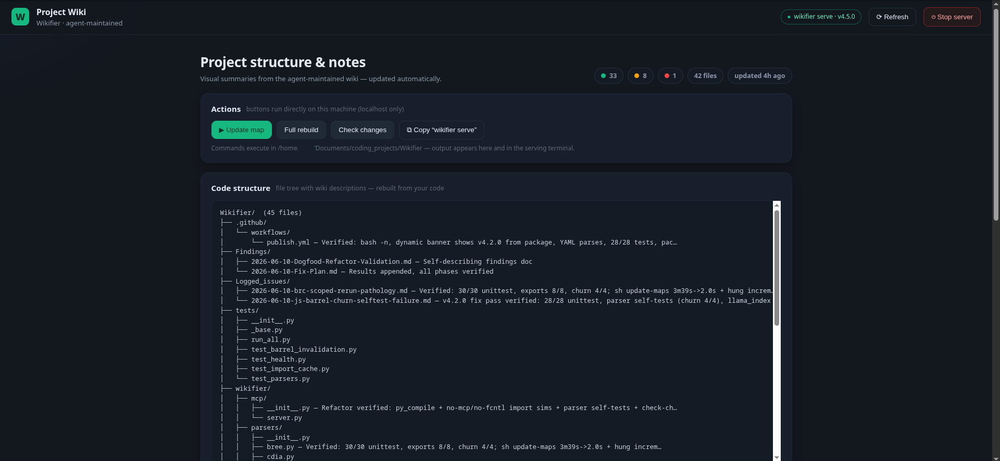

# Wikifier

[](https://opensource.org/licenses/MIT)
[](https://github.com/IronAdamant/wikifier/stargazers)

**A zero-dependency codebase wiki for AI coding agents.** Wikifier keeps a small, queryable map of a project: a dependency graph, a health matrix that says which file notes are current, short per-file wiki notes, and a journal of why each file changed. An agent asks "who imports this file?" or "what changed since the last session, and why?" and gets a few hundred bytes of JSON instead of re-reading sources.

It is one std-only Rust binary (empty `[dependencies]`) with a CLI and an MCP server (`wikifier mcp`). Agents keep the map current as they work. A small HTML dashboard exists for humans, but the product is the agent loop, not a docs site.

## Install

Download a binary from the [GitHub releases](https://github.com/IronAdamant/wikifier/releases). Each `v*.*.*` release has these archives and a `SHA256SUMS` file:

| Platform | Archive |
|---|---|
| Linux x86_64 | `wikifier-<version>-x86_64-unknown-linux-gnu.tar.gz` |
| macOS Apple silicon | `wikifier-<version>-aarch64-apple-darwin.tar.gz` |
| macOS Intel | `wikifier-<version>-x86_64-apple-darwin.tar.gz` |
| Windows x86_64 | `wikifier-<version>-x86_64-pc-windows-msvc.zip` |

Check `SHA256SUMS`, unpack, and put `wikifier` (`wikifier.exe` on Windows) on your `PATH`:

```bash
# Linux x86_64, 5.3.1
curl -fsSL -O https://github.com/IronAdamant/wikifier/releases/download/v5.3.1/SHA256SUMS
curl -fsSL -O https://github.com/IronAdamant/wikifier/releases/download/v5.3.1/wikifier-5.3.1-x86_64-unknown-linux-gnu.tar.gz
sha256sum --check --ignore-missing SHA256SUMS
tar -xzf wikifier-5.3.1-x86_64-unknown-linux-gnu.tar.gz
./wikifier --version
```

Or build from source (Rust 1.83 or newer):

```bash
git clone https://github.com/IronAdamant/wikifier
cd wikifier
cargo build --release
./target/release/wikifier --version
```

`wikifier.sh`, `wikifier.ps1`, and `wikifier.bat` run that build from a checkout (`WIKIFIER_BIN` overrides the path). `pip install wikifier` installs the archived Python 4.7 package, not this program.

## Connect an agent (MCP)

The server speaks newline-delimited JSON-RPC on stdio. With Claude Code:

```bash
claude mcp add wikifier -- wikifier mcp
```

Or add it to a project's `.mcp.json`:

```json
{
  "mcpServers": {
    "wikifier": { "command": "wikifier", "args": ["mcp"] }
  }
}
```

Every tool takes `project_root` (an absolute path). Without it the server uses `WIKIFIER_PROJECT_ROOT`, then its working directory. A call with a missing argument or an unknown file fails with a message that names the fix, and a failed call sets `isError`. To keep replies small, MCP `session_bootstrap` lists at most 100 files unless you pass `limit` (`files_total` gives the full count), the tools whose replies grow with the repository answer compactly, and every cap follows one rule: no `limit` is the tool's default, `limit: 0` is everything (the same as `full: true`), `limit: N` is at most N; and `update_maps` leaves out the edge list unless you pass `edges: true`. Then give the agent the short prompt in [`skills/run.md`](skills/run.md#paste-into-new-sessions). Any agent that can run shell commands can use the CLI instead: the daily tools have twins such as `wikifier session-bootstrap`, `prepare-edit`, and `record-change` that print the same JSON (the mapping is in `skills/run.md`).

### Tool groups

The 31 MCP tools are in six groups. The agent picks the groups a project needs with one line in the project's AGENTS.md (see Choosing groups below); an operator can override that in the MCP client's `env` block. The CLI is not affected. `WIKIFIER_TOOLS` is an allowlist and `WIKIFIER_DISABLE` hides groups or single tools after it; both take comma-separated group or tool names, ignore case and spaces, and `WIKIFIER_TOOLS` also accepts `all`. With neither set, the listing is exactly what it was; `initialize` always advertises `tools.listChanged`, so an edit to the AGENTS.md block takes effect without a restart. A block inside another fenced block (a docs example) is ignored. An unknown name, or `core` or one of its tools in `WIKIFIER_DISABLE`, stops the server with exit code 2 and a one-line message, so a mistake shows up as a failed server. An empty value counts as unset. A switched-off tool, if called, returns `isError` naming the switch to change.

| Group | Tools | Overlaps with |
|---|---|---|
| `core` (always on) | `session_bootstrap`, `prepare_edit`, `get_dependencies`, `get_dependents`, `get_file_wiki`, `list_paths`, `suggest_next_actions`, `update_maps` | — |
| `notes` | `record_change`, `record_changes`, `record_deletion`, `search_journal`, `why_file`, `journal` | Trammel notes (`add_note`) |
| `health` | `check_changes`, `mark_green`, `verify_wikis`, `health`, `validate`, `list_healable_stubs`, `heal_stubs`, `seed_source_content_hashes` | — |
| `map` | `get_resolution_diagnostics`, `get_barrel_reports`, `get_incremental_status` | — |
| `cycles` | `get_cycles` | — |
| `status` | `list_core_tools`, `get_project_status`, `get_current_project_root`, `issues`, `get_files_needing_attention` | — |

`tools/list` is 23.8 KB with every group on. The recommended lean setting keeps the whole daily loop and drops the diagnostics and the tools that repeat bootstrap: 22 tools, 17.5 KB.

```json
"env": {"WIKIFIER_DISABLE": "map,cycles,status"}
```

`WIKIFIER_TOOLS=core` alone is 8 tools and 7.2 KB, for an agent that only looks things up. Turning `notes` off also turns off `record_change`, which marks a file for its wiki refresh, so keep `notes` on unless another tool records the changes.

### Choosing groups

You, the agent, choose which Wikifier tool groups a project needs. Add one line for `wikifier` to the `agent-tools` block of the project's AGENTS.md: a fenced code block whose info string is `agent-tools`, in the project root the server uses (`WIKIFIER_PROJECT_ROOT`, else its working directory). The server re-reads the file when it changes and tells the client the tool list changed, so no restart is needed. `WIKIFIER_TOOLS` / `WIKIFIER_DISABLE` in the server's environment override the line, key by key. A mistake in the line is reported as a warning in the `initialize` instructions and the line is ignored.

| Group | What it is for | Turn it off when |
|---|---|---|
| `core` | bootstrap, lookups, dependencies, file wikis, `update_maps` | never: always on |
| `notes` | `record_change` and the journal: why each file changed, handoff reasons | another tool keeps the change notes (for example Trammel notes) and you do not maintain wikis |
| `health` | `check_changes`, `mark_green`, wiki verification | you only look things up and do not maintain wikis |
| `map` | import-resolution and barrel diagnostics | you are not debugging the import map (most sessions) |
| `cycles` | the import-cycle report | you are not untangling dependencies |
| `status` | repeats of bootstrap: project status, issues, the tool catalogue | almost always |

One agent maintaining wikis (the usual case):

```agent-tools
wikifier: disable map, cycles, status
```

Lookups only:

```agent-tools
wikifier: tools core
```

## Quick start

```bash
cd /path/to/project
wikifier init                    # path lists (src/, or the top-level dirs that hold source), empty health and journal
wikifier update-maps             # parse imports, write the map and library.md
wikifier session-bootstrap       # readiness, health counts, next actions[]

wikifier prepare-edit src/api.rs # before an edit: status, wiki, dependencies, dependents
# ... edit src/api.rs ...
wikifier record-change src/api.rs "retry on 429 (task-12)"   # the why goes to the journal
# ... update src/api.rs.wiki.md ...
wikifier mark-green src/api.rs   # refused while the wiki misses a public symbol
```

A second agent that starts cold runs `session-bootstrap`: files left Yellow come back as `actions[]` with the first agent's reason, and `search-journal` / `why-file` return the recorded reasons for any file. The full loop, JSON shapes, and every command are in [`skills/run.md`](skills/run.md).

## How it works

`update-maps` runs **scan → parse → resolve → cache → artifacts**. It walks the directories in `map_paths.txt`, parses imports with comment-masked scanners, resolves them to project files, and stores edges in a text index under `.wikifier_staging/`. Unchanged files are skipped by size and mtime, so a warm run is fast.

| Artifact | What it holds |
|---|---|
| `file_health.md` / `.json` | 🟢 Green (wiki checked against the code), 🟡 Yellow (changed, or no wiki yet), 🔴 Red (deleted) per file |
| `*.wiki.md` | Short agent-written note beside each source file |
| `journal/` + `pending_updates.md` | Why each file changed, and the work queue |
| `library.md` + `.wikifier_staging/maps/` | File tree and dependency tables; folder cards that `list-paths` returns |

`check-changes` compares files with their Green baselines. `mark-green` checks that the wiki names the file's public Python, JS/TS, or Rust symbols. Other languages are mapped and recorded as `unchecked`. `map_paths.txt` lists the import-map roots; `monitored_paths.txt` adds extra files to watch, such as docs.

| Language | Extensions | Import scan |
|---|---|---|
| Python | `.py` | relative and same-tree absolute imports; an indented import is flagged conditional |
| JavaScript / TypeScript | `.js` `.ts` `.jsx` `.tsx` `.mjs` `.cjs` `.mts` `.cts` | named re-exports followed to depth 8; `import()` flagged dynamic; reads `tsconfig.json` `paths`, `package.json` `exports`, npm `workspaces` |
| Rust | `.rs` | `mod`, `crate::`, `self::`, `super::`, and crate names from `Cargo.toml` and `[workspace] members` |
| Go | `.go` | `import` and import blocks |
| C / C++ | `.c` `.h` `.cpp` `.cc` `.cxx` `.hpp` `.hh` | `#include` |
| C# | `.cs` | `using` |
| Java | `.java` | `import`, `import static` |

The scanners are pragmatic regex, not compilers. On a very large tree, list package roots in `map_paths.txt`, or pass `--directory` / `--max-files` (a budgeted run returns `map_complete=false` and the next run resumes). Never point the project root at a folder that holds several repositories.

## Performance (measured)

Full / heavy runs (historical order-of-magnitude):

| Project | Scale | Full / heavy `update-maps` |
|---------|-------|----------------------------|
| llama_index | ~3.8k Python files | ~8.5s class full |
| Babylon.js | ~3.9k TS files, barrel-heavy | minutes full; scoped re-runs tens of seconds |
| Large trees (e.g. LLVM-scale) | tens of thousands of files | `map_paths` / `--directory` / `--max-files` — never unscoped one-shot |

Warm **0-dirty** re-runs after **4.6.7** (same machine class; scoped; candidates **reused** — agent session path). These numbers are from the Python package. This repo's map roots are now `src/` and `tests/`.

| Project | Scope | Warm `update-maps` | n |
|---------|-------|--------------------|---|
| Wikifier (self, Python era) | `map_paths`: `wikifier/` + `tests/` | **~30 ms** | 50 |
| llama_index | `llama-index-core` | **~76 ms** | 724 |
| rust | `library/std` | **~79 ms** | 719 |
| airflow | `airflow-core` | **~180 ms** | 1920 |
| Babylon.js | `packages` | **~400 ms** | 3895 |

Residual floor on large scopes is mtime/stat + live count under MapScope (not full JSON re-walk). Sub-100ms is not a hard SLA on every 1k+ tree.

## Benchmarks

Python 4.7 at `24812ef` versus the Rust binary recorded in [`scripts/benchmark_results.md`](scripts/benchmark_results.md) (that binary reported 4.7.0). 5.0.0 is that program. 5 runs, median milliseconds (min–max). Machine: Intel Xeon, 4 cores, 15.6 GiB RAM, Linux 6.12.94+, Python 3.12.3, rustc 1.83.0. Cold deletes `.wikifier_staging` first. Warm is the next `update-maps`. Full notes, peak RSS, and commands are in that file. Reproduce with `scripts/benchmark_parity.sh`.

| Command | small Python | small Rust | medium Python | medium Rust | large Python | large Rust |
|---|---:|---:|---:|---:|---:|---:|
| startup (`--version`) | 63 (61–66) | 2 (1–2) | same pair | same pair | same pair | same pair |
| cold update-maps | 123 (121–126) | 8 (7–13) | 167 (163–168) | 62 (59–73) | 12675 (12540–13094) | 3142 (3114–3305) |
| warm update-maps | 69 (67–72) | 4 (3–5) | 73 (72–74) | 4 (4–5) | 422 (417–433) | 246 (243–253) |
| session-bootstrap | 66 (64–67) | 2 (1–2) | 65 (64–67) | 2 (1–2) | 270 (269–278) | 21 (21–21) |
| check-changes | 64 (62–65) | 3 (2–3) | 70 (69–75) | 5 (5–6) | 1232 (1217–1266) | 74 (73–76) |
| health --summary | 60 (60–62) | 2 (1–2) | 60 (59–63) | 1 (1–2) | 109 (108–114) | 8 (8–9) |
| verify-wikis | 60 (60–61) | 2 (1–2) | 62 (60–67) | 1 (1–2) | 106 (103–108) | 8 (7–8) |
| cycles | 60 (60–61) | 2 (1–2) | 61 (60–63) | 2 (2–2) | 63 (61–64) | 54 (53–55) |

Resolved file edges after a warm map: small 2 and 2, medium (this repo) 44 Python and 98 Rust, large (Django `django/` + `tests/`, 2939 Python files) 9074 and 9074. Rust cold `update-maps` peak RSS was 3384 / 4424 / 40012 kbytes; Python was 27544 / 28392 / 97564 kbytes. The release binary is 2197456 bytes.

Small is three modules under `src/pkg`. Medium is `src/` and `tests/`. Large is a shallow clone of Django.

### Parser accuracy

`cargo test` checks internal edges on the frozen accuracy layouts:

| Fixture | 4.6.13 precision / recall | 4.7.0 precision / recall |
|---------|---------------------------|--------------------------|
| Django app (absolute app imports) | 1.00 / 0.29 | 1.00 / 1.00 |
| `src/`-layout package | 1.00 / 0.14 | 1.00 / 1.00 |
| TS monorepo (workspaces, paths, barrels) | 1.00 / 1.00 | 1.00 / 1.00 |
| Comment / string / regex traps | 0.29 / 0.67 | 1.00 / 1.00 |

Tests: `cargo test` (std-only Rust; accuracy fixtures, cache lookups, and the agent-loop commands).

## Human dashboard



`wikifier init` copies one `index.html`. Run `wikifier serve` and open http://localhost:8787/index.html. It is a read-only view of the same artifacts.

## Documentation

- [`skills/run.md`](skills/run.md): the agent protocol (v0.7): the daily loop, readiness, JSON shapes, and every command
- [`AGENTS.md`](AGENTS.md): start here when working on this repository
- [`CONTRIBUTING.md`](CONTRIBUTING.md): adding a command or a language
- [`docs/spec.md`](docs/spec.md): original requirements and core principles
- [`CHANGELOG.md`](CHANGELOG.md) · [Releases](https://github.com/IronAdamant/wikifier/releases)

Scope: an agent-maintained codebase wiki for token-efficient lookup. General human documentation and IDE plugins are out of scope.
