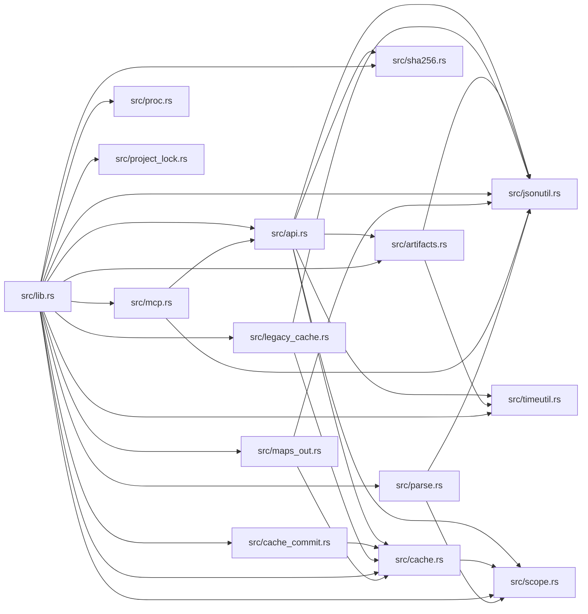

# Library

Generated by `wikifier update-maps`. Agents orient with the root folder card and `list-paths`, not this mermaid.

Files: 24. Edges: 32.

## File Tree

```text
src/api.rs
src/artifacts.rs
src/cache.rs
src/cache_commit.rs
src/jsonutil.rs
src/legacy_cache.rs
src/lib.rs
src/main.rs
src/maps_out.rs
src/mcp.rs
src/parse.rs
src/proc.rs
src/project_lock.rs
src/scope.rs
src/sha256.rs
src/timeutil.rs
tests/cache_and_artifacts.rs
tests/cli_surface.rs
tests/contract_gaps.rs
tests/dogfood.rs
tests/parity.rs
tests/protocol_v07.rs
tests/robustness.rs
tests/skip_maps.rs
```

## Dependencies



| Source | Depends on |
|--------|------------|
| src/api.rs | src/artifacts.rs, src/cache.rs, src/jsonutil.rs, src/scope.rs, src/sha256.rs, src/timeutil.rs |
| src/artifacts.rs | src/jsonutil.rs, src/timeutil.rs |
| src/cache.rs | src/scope.rs |
| src/cache_commit.rs | src/cache.rs |
| src/legacy_cache.rs | src/cache.rs, src/jsonutil.rs |
| src/lib.rs | src/api.rs, src/artifacts.rs, src/cache.rs, src/cache_commit.rs, src/jsonutil.rs, src/legacy_cache.rs, src/maps_out.rs, src/mcp.rs, src/parse.rs, src/proc.rs, src/project_lock.rs, src/scope.rs, src/sha256.rs, src/timeutil.rs |
| src/maps_out.rs | src/cache.rs, src/jsonutil.rs |
| src/mcp.rs | src/api.rs, src/jsonutil.rs |
| src/parse.rs | src/jsonutil.rs, src/scope.rs |

Edges with a conditional, dynamic, barrel, or lower-confidence flag: 0.
Run `wikifier cycles` for a break hint on each strongly connected component.
