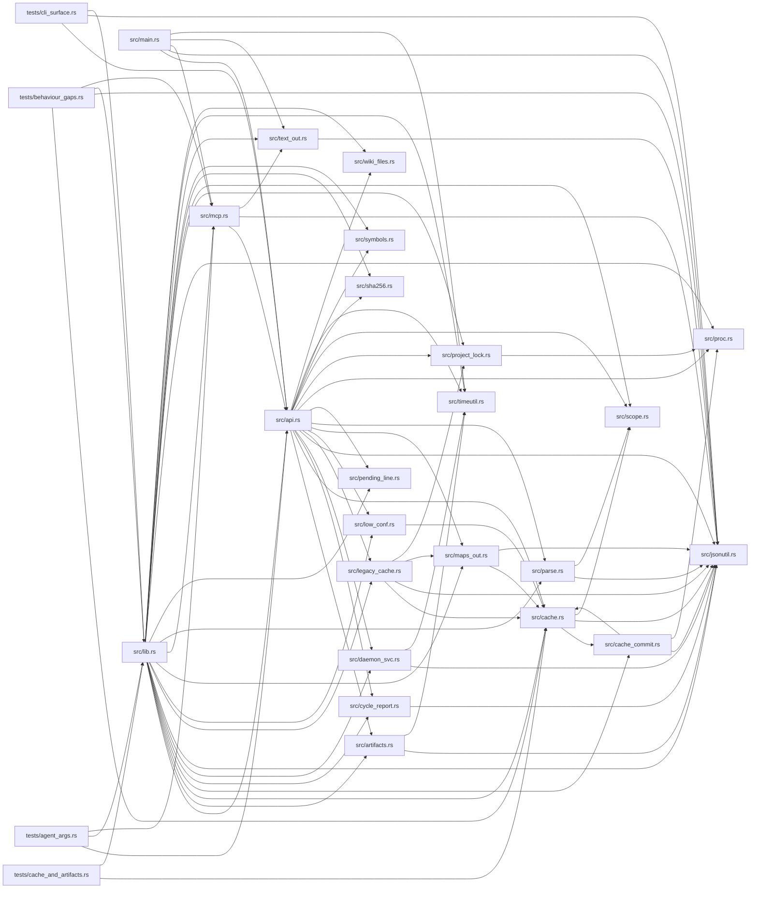

# Library

Generated by `wikifier update-maps`. Agents orient with the root folder card and `list-paths`, not this mermaid.

Files: 34. Edges: 101.

## File Tree

```text
src/api.rs
src/artifacts.rs
src/cache.rs
src/cache_commit.rs
src/cycle_report.rs
src/daemon_svc.rs
src/jsonutil.rs
src/legacy_cache.rs
src/lib.rs
src/low_conf.rs
src/main.rs
src/maps_out.rs
src/mcp.rs
src/parse.rs
src/pending_line.rs
src/proc.rs
src/project_lock.rs
src/scope.rs
src/sha256.rs
src/symbols.rs
src/text_out.rs
src/timeutil.rs
src/wiki_files.rs
tests/agent_args.rs
tests/behaviour_gaps.rs
tests/cache_and_artifacts.rs
tests/cli_surface.rs
tests/contract_gaps.rs
tests/dogfood.rs
tests/parity.rs
tests/parity_fixes.rs
tests/protocol_v07.rs
tests/robustness.rs
tests/skip_maps.rs
```

## Dependencies



Mermaid shows the first 80 edges of 101.

| Source | Depends on |
|--------|------------|
| src/api.rs | src/artifacts.rs, src/cache.rs, src/cycle_report.rs, src/daemon_svc.rs, src/jsonutil.rs, src/legacy_cache.rs, src/low_conf.rs, src/maps_out.rs, src/parse.rs, src/pending_line.rs, src/proc.rs, src/project_lock.rs, src/scope.rs, src/sha256.rs, src/symbols.rs, src/timeutil.rs, src/wiki_files.rs |
| src/artifacts.rs | src/jsonutil.rs, src/timeutil.rs |
| src/cache.rs | src/cache_commit.rs, src/jsonutil.rs, src/scope.rs |
| src/cache_commit.rs | src/cache.rs, src/jsonutil.rs, src/proc.rs |
| src/cycle_report.rs | src/jsonutil.rs |
| src/daemon_svc.rs | src/jsonutil.rs, src/timeutil.rs |
| src/legacy_cache.rs | src/cache.rs, src/jsonutil.rs, src/maps_out.rs, src/project_lock.rs |
| src/lib.rs | src/api.rs, src/artifacts.rs, src/cache.rs, src/cache_commit.rs, src/cycle_report.rs, src/daemon_svc.rs, src/jsonutil.rs, src/legacy_cache.rs, src/low_conf.rs, src/maps_out.rs, src/mcp.rs, src/parse.rs, src/pending_line.rs, src/proc.rs, src/project_lock.rs, src/scope.rs, src/sha256.rs, src/symbols.rs, src/text_out.rs, src/timeutil.rs, src/wiki_files.rs |
| src/low_conf.rs | src/cache.rs |
| src/main.rs | src/api.rs, src/jsonutil.rs, src/mcp.rs, src/text_out.rs, src/timeutil.rs |
| src/maps_out.rs | src/cache.rs, src/jsonutil.rs |
| src/mcp.rs | src/api.rs, src/jsonutil.rs, src/text_out.rs |
| src/parse.rs | src/jsonutil.rs, src/scope.rs |
| src/project_lock.rs | src/proc.rs |
| src/text_out.rs | src/jsonutil.rs |
| tests/agent_args.rs | src/api.rs, src/lib.rs, src/mcp.rs |
| tests/behaviour_gaps.rs | src/cache.rs, src/jsonutil.rs, src/lib.rs, src/mcp.rs |
| tests/cache_and_artifacts.rs | src/cache.rs, src/lib.rs |
| tests/cli_surface.rs | src/api.rs, src/jsonutil.rs, src/lib.rs |
| tests/contract_gaps.rs | src/api.rs, src/jsonutil.rs, src/lib.rs |
| tests/dogfood.rs | src/jsonutil.rs, src/lib.rs |
| tests/parity.rs | src/lib.rs |
| tests/parity_fixes.rs | src/api.rs, src/jsonutil.rs, src/mcp.rs |
| tests/protocol_v07.rs | src/api.rs, src/cache.rs, src/jsonutil.rs, src/mcp.rs |
| tests/robustness.rs | src/api.rs, src/cache.rs, src/jsonutil.rs, src/lib.rs |
| tests/skip_maps.rs | src/api.rs, src/cache.rs, src/jsonutil.rs, src/lib.rs |

Edges with a conditional, dynamic, barrel, or lower-confidence flag: 0.
Run `wikifier cycles` for a break hint on each strongly connected component.
